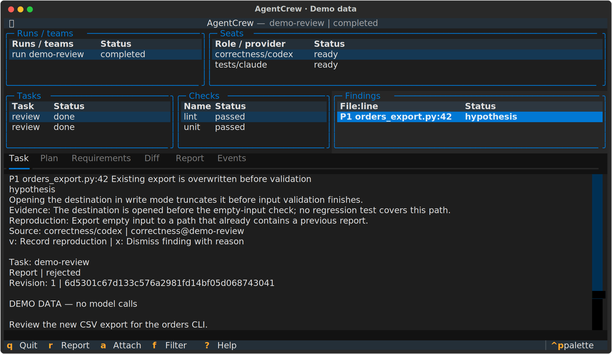

<div align="center">

<h1>AgentCrew</h1>
<p><strong>Локальная команда ИИ-агентов для разработки и ревью.<br>План, код и проверки — с привязкой к конкретному коммиту.</strong></p>

<p>
  <a href="LICENSE.md"></a>
  <a href="pyproject.toml"></a>
  <a href="#провайдеры-и-настройки"></a>
  <a href="https://github.com/balyakin/agentcrew/actions/workflows/ci.yml"></a>
  <a href="README.en.md"></a>
</p>

<a href="docs/assets/agentcrew-tui.png"></a>
<p><sub>Настоящий TUI на демонстрационных данных. Обращения к моделям не выполнялись. <a href="docs/demo.md">Как воспроизвести снимок</a>.</sub></p>

<p><a href="#установка">Установка</a> · <a href="#первая-задача">Первая задача</a> · <a href="#ревью-и-исправление">Ревью</a> · <a href="#документация">Документация</a> · <a href="README.en.md">English</a></p>

</div>

Вы описываете задачу в Markdown. AgentCrew поднимает агентов в tmux, отделяет написание кода от проверки и собирает результат: план, diff, тесты, замечания и отчёт. Можно закрыть интерфейс и вернуться позже. Работа продолжится.

У каждого кандидата есть свой Git-коммит. Один агент пишет код в отдельной рабочей копии, два других независимо проверяют зафиксированный результат; проверки проекта запускаются на том же SHA. Изменения переходят в ваш репозиторий по явной команде `apply`.

Посмотрите на скриншот: тесты зелёные, но ревьюер заметил риск потери файла. Кандидат отклонён. Именно такие детали и должны оставаться на виду.

## Для каких задач

| Нужно | Команда | Что получите |
|---|---|---|
| Добавить небольшую функцию по постановке | `develop` | План, кандидат, проверки требований и два ревью |
| Начать CLI-проект с рабочего каркаса | `new` | Python- или TypeScript-шаблон и тот же цикл разработки |
| Проверить изменения относительно ветки | `review` | Независимые ревью корректности и тестов, находки по файлам и строкам |
| Исправить конкретное замечание | `fix` | Дочерний запуск с новым кандидатом и свежей проверкой |
| Работать постоянной командой | `team up` | Роли, адресные сообщения, очередь заданий и передача результата |

Лучше начать с небольшой задачи, у которой можно назвать критерии готовности: CSV-экспорт, исправление ошибки, изменение CLI. Размытое «сделай проект хорошим» оставляет слишком много места для догадок.

## Установка

Нужны **Python 3.12+**, **Git 2.38+** и **tmux 3.3+**. Целевые платформы — Linux и macOS; для TypeScript-шаблона нужен ещё Node.js 22.18+. Результаты проверки платформ перечислены [отдельно](docs/release-checklist.md).

Установите и авторизуйте хотя бы один провайдер: [Codex CLI](https://github.com/openai/codex) или [Claude Code](https://code.claude.com/docs/en/setup). AgentCrew использует их локальные CLI. Отдельного аккаунта AgentCrew нет.

Склонируйте репозиторий и установите проект в отдельное окружение:

```sh
git clone https://github.com/balyakin/agentcrew.git
cd agentcrew
python3 -m venv .venv
source .venv/bin/activate
python -m pip install -r requirements.lock
agentcrew --version
agentcrew doctor --json
```

Так установятся AgentCrew и закреплённые версии инструментов разработки. Для выполнения самого приложения нужна одна сторонняя библиотека — Textual.

`doctor` проверяет окружение без обращения к модели. Смотрите и на состояние выбранного провайдера: общий инфраструктурный `ok` ещё не подтверждает его авторизацию. Для Claude нужна дополнительная проверка режима без записи на установленной версии:

```sh
agentcrew doctor --smoke --provider claude --yes
```

**Smoke-проверка обращается к модели и расходует её лимиты.** Для Codex аналогичная проверка запускается с `--provider codex`. После обновления Claude проверку его режима нужно повторить.

## Первая задача

В репозитории есть [постановка CSV-экспорта](examples/task.md). Каркас уже умеет показывать статус и содержит данные заказов; экспорт агентам предстоит написать. Заодно проверятся сортировка, экранирование, пустой ввод и сохранность существующего файла.

Из каталога AgentCrew, с активным окружением:

```sh
AGENTCREW_DEMO_DIR="$(mktemp -d)"
cp examples/task.md "$AGENTCREW_DEMO_DIR/task.md"
agentcrew new --directory "$AGENTCREW_DEMO_DIR/orders" \
  --template python-cli \
  --spec "$AGENTCREW_DEMO_DIR/task.md" \
  --provider codex
```

Эта команда уже запускает работу с моделью. Перед первым обращением AgentCrew покажет провайдера, права, передачу исходников, команды проверок и лимит времени. Прочитайте их. Добавляйте `--yes`, когда готовы явно принять эти условия.

Запуск напечатает ID. Подставьте его вместо `RUN_ID` и разберите результат:

```sh
agentcrew plan RUN_ID --format md
agentcrew diff RUN_ID
agentcrew report RUN_ID --format md
agentcrew apply RUN_ID --dry-run
```

Если кандидат принят и изменения вас устраивают, примените их и попробуйте экспорт:

```sh
agentcrew apply RUN_ID
cd "$AGENTCREW_DEMO_DIR/orders"
python orders_cli.py export-orders --output orders.csv
```

Для TypeScript выберите `--template typescript-cli`; после применения команда будет `node --experimental-strip-types src/cli.ts export-orders --output orders.csv`. Каталог для `new` должен быть пустым и находиться вне существующего Git-репозитория.

<details>
<summary><strong>У меня уже есть проект</strong></summary>

Начните с чистой рабочей копии Git. Постановку храните вне проекта или закоммитьте заранее.

```sh
cd /path/to/your/project
agentcrew init --lang ru
# Проверьте .agentcrew.toml: команды должны соответствовать вашему проекту.
git add .agentcrew.toml
git commit -m "Configure AgentCrew checks"
agentcrew develop --spec /path/to/task.md --provider codex
```

`init` только пишет конфигурацию. Для Python он предлагает pytest с JUnit и ruff, для Node — `npm test`. Установите нужные вашему проекту зависимости в окружении, доступном из отдельных рабочих копий. Дальше используйте те же `plan`, `diff`, `report` и `apply`.

</details>

## Ревью и исправление

Переключитесь в чистую feature-ветку с закоммиченными изменениями относительно `main`. Создайте и проверьте `.agentcrew.toml` через `init`, если её ещё нет.

```sh
agentcrew review --base main --provider codex
agentcrew report RUN_ID --format md
agentcrew finding RUN_ID FINDING_ID
```

`RUN_ID` и `FINDING_ID` берутся из вывода запуска и отчёта. У находок разные степени подтверждения:

| Статус | Основание |
|---|---|
| `reported` | Замечание одного ревьюера; пока гипотеза |
| `corroborated` | Независимые ревьюеры согласились |
| `reproduced` | Есть результат проверки или ручное подтверждение с записью |

Выберите находку для исправления:

```sh
agentcrew fix RUN_ID --finding FINDING_ID
agentcrew report FIX_RUN_ID --format md
agentcrew diff FIX_RUN_ID
agentcrew apply FIX_RUN_ID --dry-run
agentcrew apply FIX_RUN_ID
```

`FIX_RUN_ID` — ID нового запуска. У него собственный коммит, проверки и ревью. Старые зелёные тесты не засчитываются исправлению.

Если конфигурации проверок нет, можно явно выбрать `review --no-checks`. Отчёт получится частичным.

## Что считается готовым

**Постановка → план → один писатель → коммит кандидата → проверки и два ревью → решение.** При необходимости цикл повторяется; по умолчанию допускаются две дополнительные ревизии.

Требования из плана сверяются с результатами проверок этого кандидата. Для автоматического критерия нужны JUnit и точный test ID: pytest `tests/file.py::test_name` либо имя теста native Node. Общая зелёная сводка без нужного теста оставляет критерий `unknown`. Сбой ревьюера тоже блокирует принятие.

`apply` проверяет, что исходный HEAD не изменился, рабочая копия чиста, а кандидат принят. Предварительный `--dry-run` позволяет проверить перенос. Принудительное применение непринятого результата требует отдельного `--allow-unaccepted`; используйте его только после разбора отчёта.

<details>
<summary><strong>Фоновая работа, TUI и восстановление</strong></summary>

```sh
agentcrew status --json
agentcrew tui --lang ru
agentcrew attach RUN_ID correctness
agentcrew pause RUN_ID
agentcrew resume RUN_ID
agentcrew answer RUN_ID --body-file answer.md
agentcrew cancel RUN_ID
agentcrew recover --plan
```

В TUI: `r` — отчёт, `a` — подключение к роли, `f` — фильтр, `?` — справка, `q` — выход. CLI и TUI читают одно сохранённое состояние.

Для запуска в фоне добавьте `--detach`. Ctrl-C отсоединяет ожидающего клиента; выход из TUI также оставляет работу в tmux. `cancel` останавливает запуск явно. После перезагрузки сначала откройте план восстановления: процессы tmux не переживают reboot, а незаконченная запись не воспроизводится молча.

Ручной критерий можно подтвердить с описанием наблюдения:

```sh
agentcrew confirm RUN_ID REQUIREMENT_ID --status passed \
  --evidence "Что именно проверено и какой получен результат"
```

Коды выхода: `0` — успех команды, `1` — непринятая работа, `2` — неверный ввод или окружение, `3` — сбой процесса или хранилища, `130` — отсоединение клиента. Успешное чтение отчёта не меняет результат запуска.

</details>

<details>
<summary><strong>Постоянная команда и очередь</strong></summary>

```sh
agentcrew team up --template pair --cwd . --provider codex
agentcrew team ps
agentcrew send dev-owner@TEAM_ID --body-file note.md --verify
agentcrew queue create --to dev-owner@TEAM_ID --body-file task.md
agentcrew queue list --team TEAM_ID
agentcrew queue handoff TASK_ID --to dev-check@TEAM_ID \
  --note "Проверь зафиксированный результат"
agentcrew team stop TEAM_ID --snapshot
agentcrew team resume TEAM_ID
```

Сообщения сохраняются. У заданий есть владелец; передача требует зафиксированного контроллером коммита либо некодового артефакта с хешем. `--verify` у сообщения подтверждает доставку во входящие. Прочтение и выполнение проверяются отдельно.

Шаблон `pair` даёт одного писателя и одного проверяющего. Для полной приёмки `develop` нужны два независимых ревьюера. Есть также `review`, `adversarial-review` и [пример собственной команды](examples/sample-team.toml).

</details>

## Провайдеры и настройки

Всё, что относится к проекту, лежит в `.agentcrew.toml`: язык, роли, провайдеры, модели, команды проверок и ограничения. Название модели задаётся явно; встроенного каталога моделей нет.

Можно распределить роли между Codex и Claude через `[roles.<role>].provider`. Запускайте такую команду без `--provider`, чтобы сохранить назначение ролей. По умолчанию review ограничен 15 минутами, develop — 30; одновременно разрешены два обращения к агентам.

`--lang ru` включает русскую справку, сообщения и текстовые отчёты. Без флага используется язык конфигурации, по умолчанию английский. Имена команд и ключи JSON остаются стабильными.

## Границы и состояние проекта

AgentCrew работает на вашей машине. Worktree отделяет изменения от исходной ветки; системной песочницей он не является. Проверки исполняют код репозитория, а выбранный провайдер может получить исходники. Эти настройки нужно учитывать при выборе проекта и аккаунта.

Состояние хранится в `$XDG_STATE_HOME/agentcrew` или `~/.local/state/agentcrew`. Сырые трассы могут содержать код и приватные данные. Перед публикацией отчётов изучите [правила хранения и экспорта](docs/security.md).

**Стадия: предварительная версия.** В метаданных стоит `1.0.0`, публичная приёмка ещё не завершена. Последний полный локальный прогон на Linux: **323 passed, 9 skipped**; девять пропусков относятся к платным проверкам реальных провайдеров. [Результаты и исправления](docs/code-review-2026-10-05.md) записаны 5 октября 2026 года. Реальные Codex/Claude-сценарии, macOS и пользовательский пилот остаются в [плане приёмки](docs/release-checklist.md).

## Документация

| Материал | Когда открыть |
|---|---|
| [Архитектура](docs/architecture.md) | Разобраться в ролях, кандидатах и сохранённом состоянии |
| [Восстановление и ошибки](docs/troubleshooting.md) | Запуск прервался или нужно понять неполный отчёт |
| [Безопасность](docs/security.md) | Проверить права, передачу кода и хранение журналов |
| [Демонстрация](docs/demo.md) | Воспроизвести скриншот или посмотреть запись CLI |
| [Участие в разработке](CONTRIBUTING.md) | Подготовить изменение и запустить локальные проверки |
| [История изменений](CHANGELOG.md) | Посмотреть состав текущей версии |
| [Протокол оценки](docs/eval.md) | Проверить качество на реальных задачах |

## Лицензия

[MIT](LICENSE.md) · Copyright (c) 2026 **Evgeny Balyakin**.
