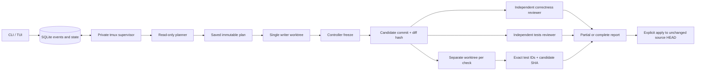

# Architecture

SQLite is the authority for scopes, roles, tasks, inbox messages, leases, candidates, checks and evidence. Tmux keeps processes alive when a client disconnects; it is not the database and does not survive reboot.

## Identity and isolation

`run_id`/`team_id` are UUIDs; `role@scope` is a stable seat address, while each worker process receives a new instance ID. Task completion must match the current lease owner and attempt. Late results cannot overwrite a newer claim.

A run saves `source_head_sha` separately from review `base_sha`. Every frozen result receives a new `candidate_id`, commit SHA, revision and diff SHA-256. Old evidence stays attached to its candidate. Apply compares the source HEAD with its saved original HEAD and generates the patch from that HEAD to the selected candidate; it does not use the review merge-base as the source to rewrite.

Workers retain provider-issued session IDs. They use native resume only after the installed adapter confirms its structured-output and permission flags. A fresh process otherwise receives brief SQLite context and emits `session_restarted`; hidden model context is not claimed to survive.

Planner/reviewers use separate read-only provider policies. The implementer is the single writer for its active workflow. After validation, the controller commits only in an owned AgentCrew branch. Each configured check receives a fresh worktree at that candidate; check side effects do not alter the source checkout.

## Evidence and outcome

Provider-facing schemas are closed: plan, implementation and review reject unexpected fields. Model declarations never contain trusted `accepted` or `tests_passed` fields. Local validation adds bounded strings/lists, existing candidate paths/lines, ID references and dependency-cycle checks.

JUnit is read only after the configured argv command runs in a new checks-worktree. Previous result files are removed there; paths remain inside it, XML entities are rejected, and the new file is hashed. A requirement needs the exact executed test ID, matching check and current candidate. Skipped/suppressed/duplicate IDs and missing reports do not establish a pass. Manual criteria need a candidate-bound decision with actor and observed evidence.

Only check IDs returned by the current completed checks task establish workflow evidence. A failed or incomplete retry cannot inherit an earlier PASS on the same candidate; earlier records remain available for audit. Finding identities preserve the exact detail and evidence, including case and spaces in code literals, so a dismissal cannot transfer to a different defect.

Develop acceptance requires every configured check and requirement to pass, both independent reviewers to finish with valid results, no unresolved finding and intact isolation. Review without checks is partial. One failed reviewer is shown as a failure with an unknown finding count, never an empty successful result. Agreement between models gives corroboration, not reproduction.

Workflow usage/cost includes recorded prior revisions. If any call's measurement is missing or an invalid format attempt lacks complete metrics, totals remain unknown. Duration is never converted into an estimated price.

## Recovery and teams

Queue claims, dependencies, inbox transitions and events use transactions. The supervisor is a singleton on a private tmux socket. Pause stops new work while allowing an active writer to finish; cancel retains partial artifacts. Recovery inspects the database, process state and owned worktrees. A crashed writer requires inspection before retry.

Freeze records the candidate, worktree reference and `verify` checkpoint in one SQLite transaction after Git operations. Verification creates only missing role tasks. Explicit writer inspection authorizes one retry attempt at the same HEAD in the same verified worktree; it does not permit automatic replay after another crash. Generic manual task completion is available for teams; workflow tasks require their validated provider or check result.

Persistent templates give roles explicit directed links. Handoff closes the former ownership and creates the recipient task atomically, carrying a frozen commit/diff hash or a hashed artifact. The built-in pair is one writer plus one checker; its review does not meet the standard two-reviewer develop acceptance by itself.

See [security](security.md), [troubleshooting](troubleshooting.md) and the evidence ledger in [progress](progress.md).
